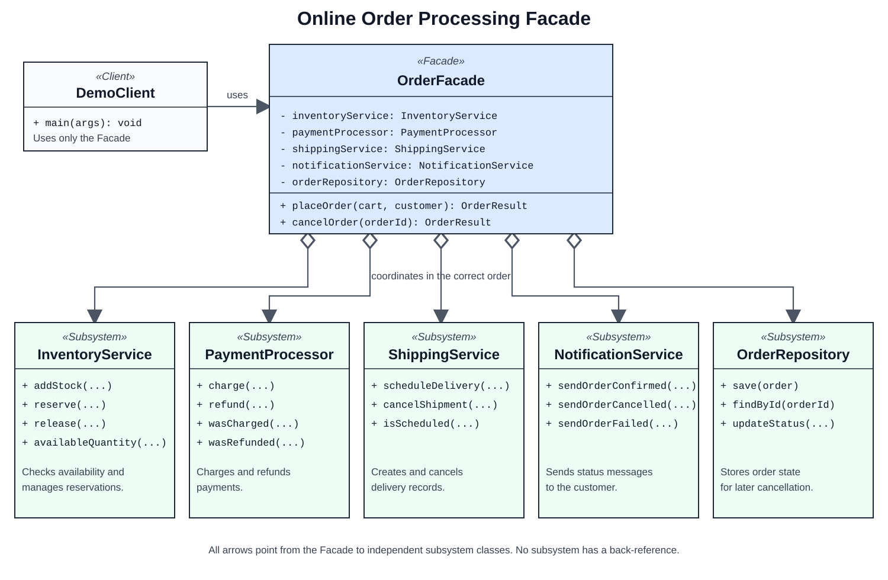

# Assignment 4 Facade Pattern

This Java 17 project demonstrates the Facade structural design pattern with an online order processing system. `OrderFacade` gives the client two simple operations: place an order and cancel an order. It coordinates inventory, payment, shipping, notifications, and order storage in the correct sequence.

## Why the Facade is useful

Without the Facade, a client must reserve stock, charge the payment, schedule delivery, save the order, send a notification, and remember every rollback step. With the Facade, the client calls only:

```java
OrderResult result = orderFacade.placeOrder(cart, customer);
orderFacade.cancelOrder(result.orderId());
```

If payment fails, reserved stock is released. If shipping fails, the payment is refunded and stock is released.

## Project structure

```text
src/main/java/kz/edu/facade/
├── client/      Demo client that uses only OrderFacade
├── config/      Creates and connects the subsystem objects
├── facade/      Simplified public API and coordination logic
├── model/       Cart, customer, order, and result data
└── subsystem/   Inventory, payment, shipping, notification, repository
src/test/java/   Seven JUnit 5 tests
docs/            UML source, UML image, report, and defense notes
```

## Run the project

Requirements: JDK 17 or newer and Maven 3.9 or newer.

```bash
mvn test
mvn exec:java
```

The tests cover successful placement, insufficient stock, declined payment, failed shipping with rollback, cancellation, repeated cancellation, and repeated cart items.

## UML



The subsystem classes do not know about `OrderFacade`. They remain public and can still be used directly by advanced clients. `DemoClient` depends only on the Facade and simple model classes.

## Author

Amirkhan Tulkibayev, group SE-2522

Repository: <https://github.com/hann-qaz/Assignment4_facade_pattern>

